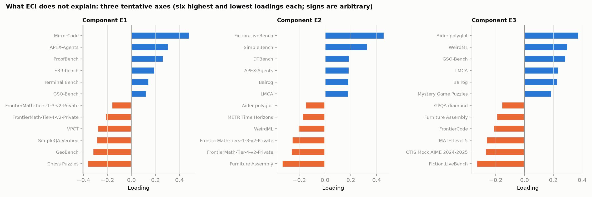

# What does the Epoch Capabilities Index lose?

The [Epoch Capabilities Index (ECI)](https://epoch.ai/eci) combines scores from many AI benchmarks into one number per model. This project asks what that aggregation keeps and what it loses, using the benchmark data Epoch publishes. How each number is computed is in [`METHODOLOGY.md`](METHODOLOGY.md).

**Sample:** 191 models × 29 benchmarks (2,078 scores; 37.5% of cells observed).

**One approach throughout.** Every step uses the same scale, model and weighting. Scores are on the logit scale, where the ECI's S-curve becomes a straight line. Each benchmark gets its own intercept and slope in the score(s). Every observed score counts once after each benchmark is scaled to unit spread, so benchmarks scored on more models count more; this is what PCA with missing data does.

## The argument

### 1. Aggregating many benchmarks into one number must lose some variation
For each benchmark, fit the ECI's own S-curve (a straight line in the ECI on logit scores) and ask how much of the benchmark's variation across models it captures. Overall the ECI explains **83%** of the variation within benchmarks, so **17% is lost**, and the loss is uneven. It explains 93–96% of METR Time Horizons, FrontierMath Tiers 1–3, GPQA, ARC-AGI and AIME, but only **23% of GeoBench**, 49% of MirrorCode, 55% of VPCT, 57% of Fiction.LiveBench, 61% of Mystery Game Puzzles and 62% of SimpleQA. Some of these low values come partly from which models were tested (see caveats): GeoBench and SimpleQA were run on a wide range of models, but MirrorCode, Fiction.LiveBench and VPCT mostly on recent, strong ones.

**How the ECI itself treats these benchmarks.** Epoch's current, Bayesian ECI gives each benchmark its own noise level: how widely scores scatter around the benchmark's S-curve.[^bayes] Epoch does not publish these levels. They can be recovered from the difficulties and slopes it does publish, and the recovered values match the two examples Epoch gives: a model predicted to score 50% typically lands within ±3 points on METR Time Horizons and ±17 on VPCT. **The benchmarks the ECI fits worst are the ones its model treats as noisiest.** MirrorCode, VPCT and GeoBench are the three noisiest of the 29; Fiction.LiveBench ranks 5th, SimpleQA 7th and Mystery Game Puzzles 8th. Across all 29, fit and noise have a rank correlation of −0.79. GeoBench's scores scatter almost five times as widely as METR's.

So the model absorbs what one number cannot explain on these benchmarks into their noise term. As Epoch notes, a score's informativeness depends on its benchmark's noise, so scores on these benchmarks move the ECI less. A one-factor model cannot tell a noisy benchmark from one that measures a different ability: both look like scatter around the curve. Point 3 suggests that at least some of this scatter is not noise. What the ECI leaves out is correlated across benchmarks in a way shuffled noise is not.


### 2. The ECI is essentially the first principal component of the benchmarks
PCA on the benchmarks (each benchmark's intercept estimated together with the components; see [`METHODOLOGY.md` §4.2](METHODOLOGY.md#42-two-ways-of-centering-conventional-a-and-joint-intercepts-aj)) gives a first component that correlates **r = 0.995** [0.994, 0.997] with the ECI. It explains **84.5%** of within-benchmark variation, against 83.4% for the ECI itself. The second component adds 5.4%, the third 2.7%, and each later one less. Points 1 and 2 confirm, on this subset, what Epoch has itself reported.[^epoch]


### 3. Remove what the ECI explains: what is left?
After subtracting from each benchmark the line that the ECI explains, the leftover variation is largest for the benchmarks in point 1: GeoBench, MirrorCode, VPCT, Fiction.LiveBench, Mystery Game Puzzles and SimpleQA. These are the benchmarks, and the abilities they test (for example geolocation, visual reasoning, long-context fiction and factual recall), that the ECI undervalues.

Is there shared structure in the leftover? Some. The same PCA applied to the leftover finds **three components that each capture more of it than chance**. "Chance" here is the 95th percentile when the leftover is shuffled among models within each benchmark. The three components capture 24%, 18% and 16% of the leftover, against 17%, 15% and 14% for shuffled data. From the fourth component on, the real leftover falls below the shuffled line. The components are only moderately stable when models are resampled (cosine 0.62–0.72), so treat their labels as tentative. The clearest, E1, contrasts agentic and coding benchmarks (MirrorCode, APEX-Agents, ProofBench) with chess, GeoBench, SimpleQA and VPCT. It matches the axis Epoch has called "Claudiness", though in the current data it is no longer specific to Claude.[^claudiness]




### 4. How much should the index care about the worst-fitted benchmark?
Build the one-number score by minimizing a power mean, over benchmarks, of the share of each benchmark the score leaves unexplained (1 − R², weighted by the number of models on each benchmark). The power p sets how much the worst-fitted benchmark matters, from not specially (p = 1) to exclusively (p = ∞):
- **p = 1** (arithmetic mean) is exactly the first principal component of point 2.
- **p = ∞** cares only about the worst-fitted benchmark.

| Score | Mean R² | Worst R² | Corr. with ECI | SD of score change (points) | Max change (points) |
|---|---|---|---|---|---|
| Official ECI | 0.83 | 0.23 (GeoBench) | 1.000 | 0 | 0 |
| p = 1 (average = first PC) | 0.85 | 0.27 (GeoBench) | 0.995 | 1.3 | 4.6 |
| p = ∞ (worst benchmark) | 0.75 | 0.71 (GeoBench) | 0.928 | 5.2 | 22.1 |

- p = 1 reproduces the ECI to within its own uncertainty (typical 90% half-width 2.5 points; Epoch publishes 90% intervals).
- Caring only about the worst benchmark changes the scores a lot. GeoBench's R² rises from 0.23 to 0.71, but METR, ARC-AGI and AIME drop from 0.93–0.96 to 0.72–0.78, and some models move by 20+ points (Gemini 1.5 Flash +22, Qwen 3.8 27B −21). The ten models that move most have somewhat fewer scores than average (median 7 against 9). Its record-setters are mostly Google models.[^gemini] This is not a better index, only one built on a different value: that no ability should be left out.


**Over time.** Like Epoch's chart of ECI against release date, `fig12` plots each score against release date with its frontier (the models that set a record when they were released).
- p = 1 tracks the official frontier: +16.2 points per year against +16.3 for the official ECI, with 86% of the same record-setting models.
- p = ∞ gives a flatter frontier (+13.6 per year) and changes who sets records (28% overlap). That comes from a few early models with few scores, such as GPT-4 and Gemini 1.5 Flash, boosted by 15–22 points. Among models with at least 8 scores, the frontier slope is the same under every p (17.6–17.7 points per year, against 17.9 for the ECI).
- The newest frontier model (Claude Fable 5.2) is the same under every p.

**With a break in April 2024.** Epoch has estimated that the ECI frontier sped up around 8 April 2024. `fig13` fits a two-segment line to each frontier, with the break fixed at that date. The two segments join at the break.
- After the break, every p gives a similar slope: +15.8 to +17.3 points per year, against +17.1 for the official ECI. Among models with at least 8 scores the range is +16.3 to +17.8.
- Before the break, the slope can't be estimated from this sample. The 191 models start in June 2023, so each score has only 1–3 record-setting models before April 2024.
- For reference, the official ECI over all of Epoch's models gives +14.4 before the break and +17.0 after, still from only 4 record-setters before the break.
- So how much the index cares about the worst benchmark does not change the post-2024 rate of progress, and this data can't say whether the speed-up itself would survive.


## Main caveats
(Full list in [`METHODOLOGY.md` §9](METHODOLOGY.md#9-caveats).)
- On the logit scale, scores of 0% and 100% must be clipped to 1% and 99%. Benchmarks with many such scores look less well explained partly because of where the clip is set. On raw scores, Mystery Game Puzzles (18% of scores at the clip) is 89% explained rather than 61%, and Furniture Assembly (26%) 91% rather than 79%. Benchmarks with no clipped scores (GeoBench, MirrorCode, Fiction.LiveBench, SimpleQA) are unaffected.
- The data are sparse and not random; conclusions concern a 29-benchmark subset, and the ECI also uses other benchmarks.
- R² depends on which models were tested. A benchmark run only on a narrow band of models looks less well explained, even if it tracks the ECI closely. MirrorCode, Fiction.LiveBench and VPCT were run mostly on recent, strong models (ECI spread 5–8 points, against 14 for all models). A standard correction for this (Thorndike Case II) puts them at 0.80–0.89 rather than 0.49–0.57. GeoBench (0.29) and SimpleQA (0.77) remain poorly explained under it. The correction assumes each benchmark's line in the ECI extends beyond the models tested, so the main results use the uncorrected R².
- Noise lowers R² too: part of what the ECI leaves unexplained on a small benchmark may be measurement noise rather than an undervalued ability.
- The residual structure is modest (three components above chance, moderately stable) and its labels are interpretation.
- The p-norm scores approximate the ECI with a simpler model (no priors; scale set by matching the ECI's mean and SD rather than Epoch's anchors). There is no external ground truth for "better", and the p = ∞ score is fragile in sparse data.
- Confidence intervals treat models as independent, so they are too narrow.

## Running it
```
pip install pandas numpy scipy matplotlib
python -I scripts/download_data.py data
python -I scripts/01_pc1_vs_eci.py       data/extracted results/01_pc1_vs_eci
python -I scripts/02_eci_residual.py     data/extracted results/02_eci_residual
python -I scripts/03_loss_functions.py   data/extracted results/03_loss_functions
python -I scripts/04_make_figures.py     data/extracted results
python -I scripts/05_claudiness.py       data/extracted results
```

## Files
- `METHODOLOGY.md`: how every number is computed, with equations, scripts and caveats.
- `scripts/`: `common.py` (shared code), `download_data.py`, `01_` to `04_` for the four steps and figures, and `05_claudiness.py` for the comparison in the note on Claudiness.
- `results/`: saved tables, logs, and `figures/` (`fig01`–`fig13`; there is no `fig11`).

## Data snapshot
Data: Epoch AI, "Capabilities & benchmarking", https://epoch.ai/benchmarks (CC-BY 4.0). Not redistributed here; the download script fetches it.

Epoch updates this file regularly, so a new download will give somewhat different numbers. The saved results use the file downloaded on **15 November 2026**:
- `benchmark_data.zip`, 2,311,552 bytes, SHA-256 `d2c8ab82bfce75c8f244232ee0027ddc648a5b30a13e73f847618875e8d31d8f`
- 256 models in `eci_scores.csv`, the latest released 9 November 2026

`download_data.py` writes the date and checksum of what it fetched to `data/SNAPSHOT.txt` and warns if they differ from this snapshot.

## Notes

[^epoch]: Epoch's paper describing an earlier version of the ECI method reports a similar per-benchmark fit for its model: "the average R2 value is 0.71 for benchmarks with more than 25 scores, and 0.81 for benchmarks with more than 40 scores." On GeoBench it notes "we see Gemini models doing better than predicted and several Claude models doing worse than predicted," which it calls "weak evidence" that labs optimize for different things. It also says the single-number assumption "is of course not the case" (A. Ho, J.-S. Denain, D. Atanasov, S. Albanie, R. Shah, ["A Rosetta Stone for AI Benchmarks"](https://arxiv.org/abs/2512.00193), arXiv 2512.00193, November 2025, §2.1 and §3.1.2). A PCA of the same data by G. Burnham found one dominant dimension (see the note on Claudiness). What this project adds is points 3 and 4.

[^bayes]: E. Álvarez and A. Barry, ["Updating the ECI methodology to use a Bayesian model"](https://epoch.ai/publications/eci-bayesian-methodology), Epoch AI, 4 November 2026. The noise term lets "the model learn that observed scores scatter more around their predictions on some benchmarks than on others", and "a score's informativeness depends on the benchmark's slope and how far the model's capability is from the benchmark's difficulty as well as its level of noise." The ECI analysed here is this Bayesian version. The noise levels are recovered as the root-mean-square of each benchmark's standardized residuals under Epoch's fitted model (`scripts/01_pc1_vs_eci.py`; `epoch_noise_sigma_b` in `results/01_pc1_vs_eci/per_benchmark_explained.csv`). The previous, frequentist ECI minimized squared error on raw scores with every score counting once. That fit is close to the first principal component of point 2 by construction, and the two ECIs agree closely above ECI 125 (R² 0.995 in Epoch's comparison).

[^claudiness]: This axis matches the second component G. Burnham found in Epoch's benchmark data and called "Claudiness" (["Benchmark Scores = General Capability + Claudiness"](https://epoch.ai/gradient-updates/benchmark-scores-general-capability-claudiness), Epoch AI Gradient Updates, 20 November 2025). He published only his seven largest weights. On the two of those benchmarks in this sample the weights agree (VPCT −0.28 vs −0.28; FrontierMath Tier 4 −0.26 vs −0.22). His other five, mostly agentic computer-use tasks, are scored on 13 or fewer models in Epoch's data. The models he names as most and least Claude-like sit at the 75th–90th and 13th–39th percentiles of E1. In the current data, though, the axis is not specific to Claude. Developer explains 12% of E1 and Anthropic against all others 3%. xAI and Z.ai average higher than Anthropic, and Claude Opus versions range from the 43rd percentile (Opus 4.7) to the 91st (Opus 4.1). E1 is better read as a trade-off between agentic coding and factual recall, geolocation and visual tasks, on which particular model generations differ. Burnham's method also differs: an ordinary PCA of 39 benchmarks with missing scores filled in from similar models, not a PCA of what the ECI leaves out. (`scripts/05_claudiness.py`; `results/05_claudiness/`.)

[^gemini]: Under p = ∞, Google DeepMind models make up 7 of the 16 record-setters (3 of 25 under the official ECI), while OpenAI's fall from 16 to 4. Google models also gain the most on average (+1.6 points). The binding benchmark is GeoBench, on which Epoch's paper found Gemini models do better than predicted (see the note on Epoch's earlier findings). So the worst-benchmark index largely rewards one developer's strength on one benchmark. (`results/03_loss_functions/loss_by_developer.csv`.)
