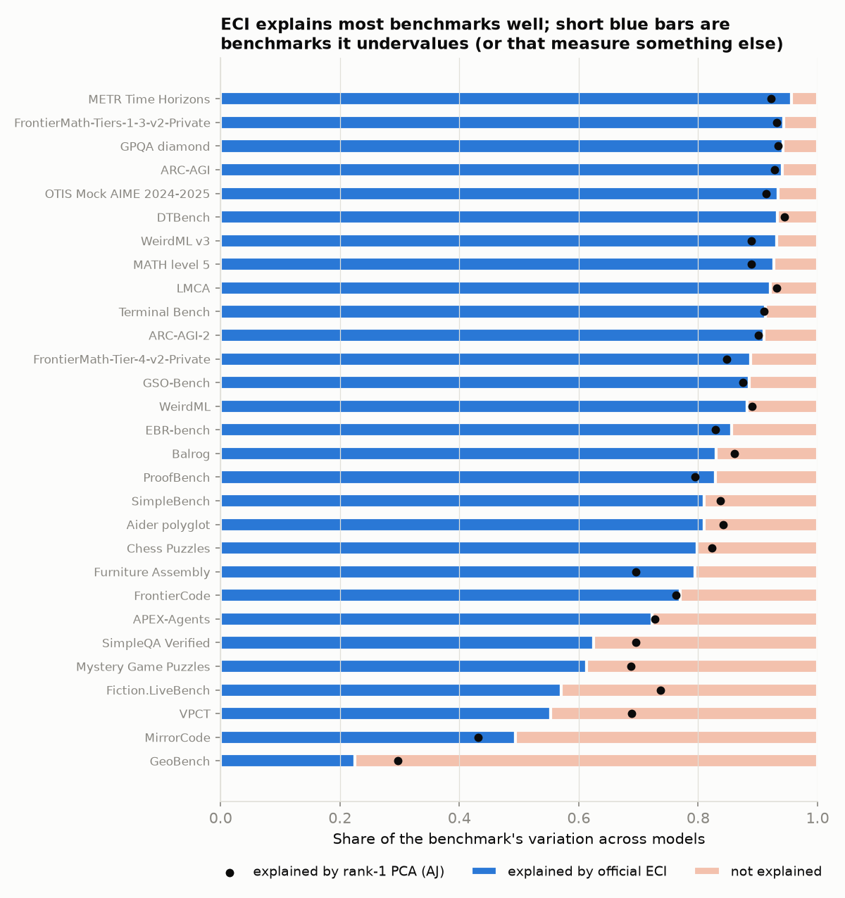
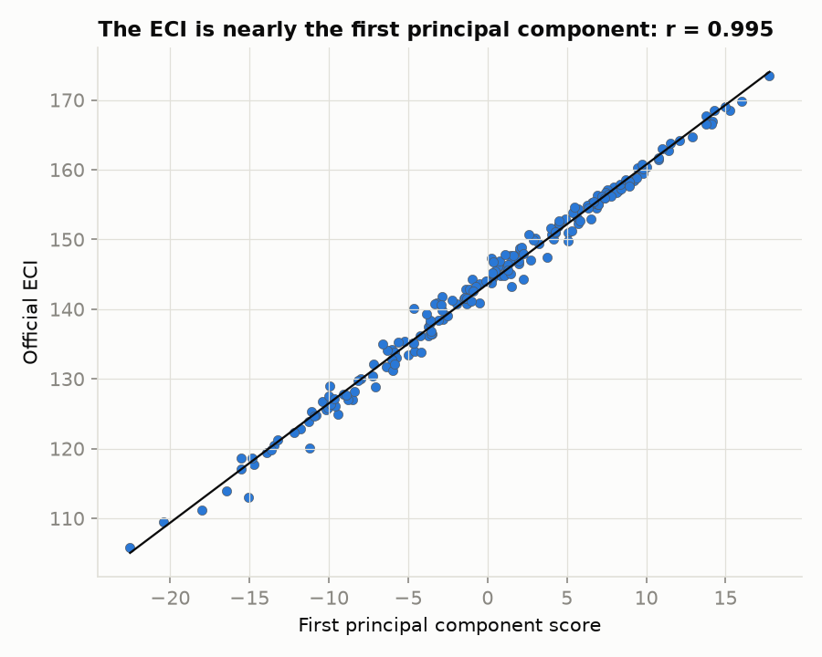
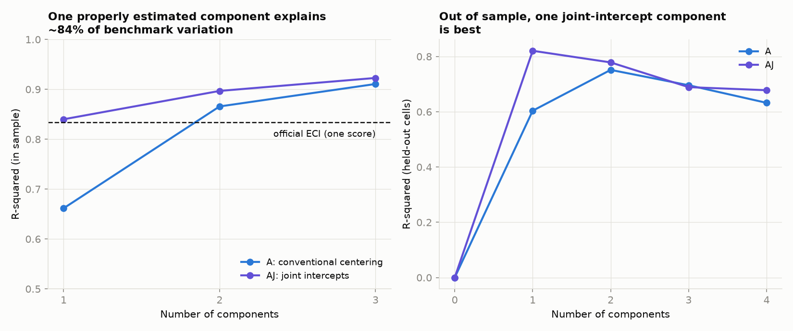
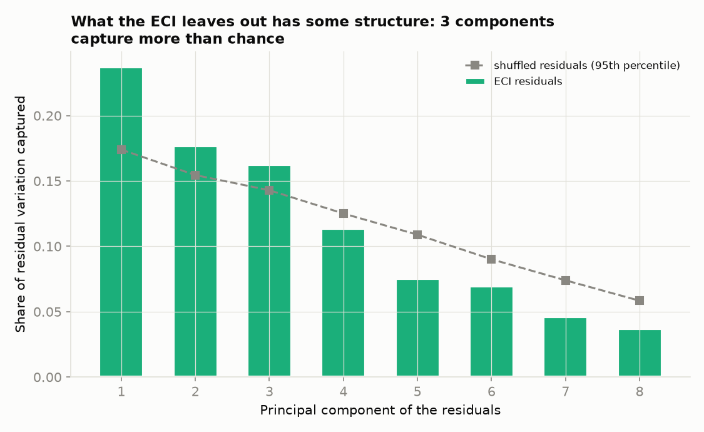
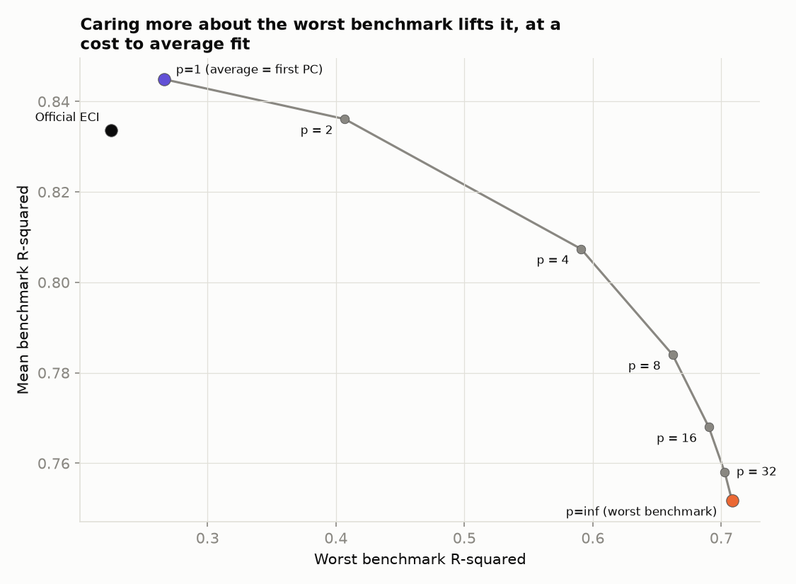
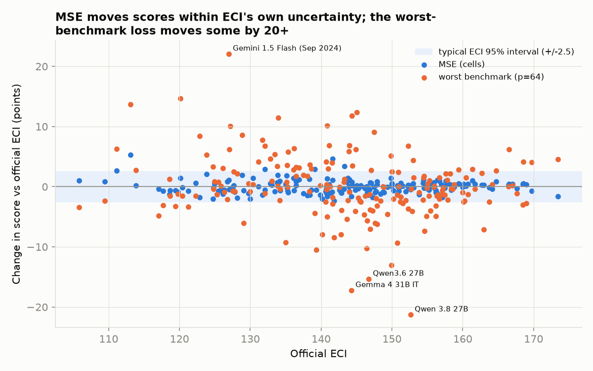
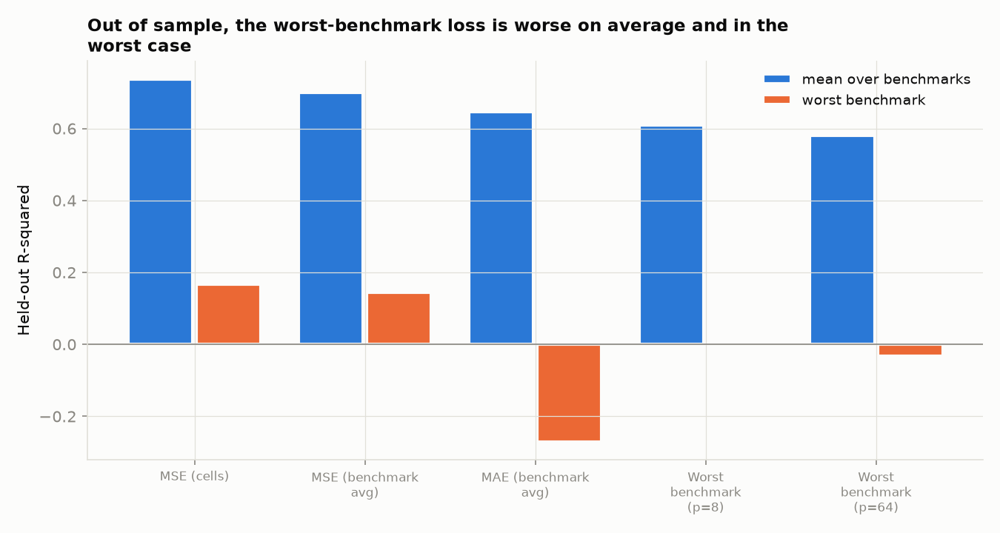
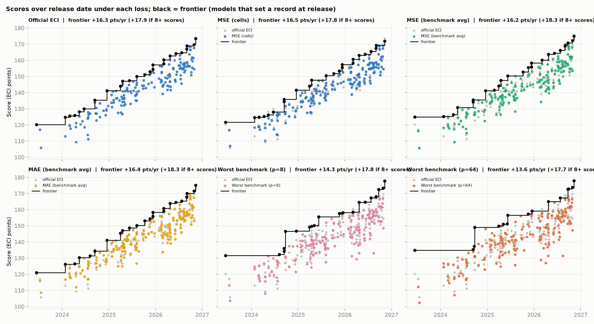
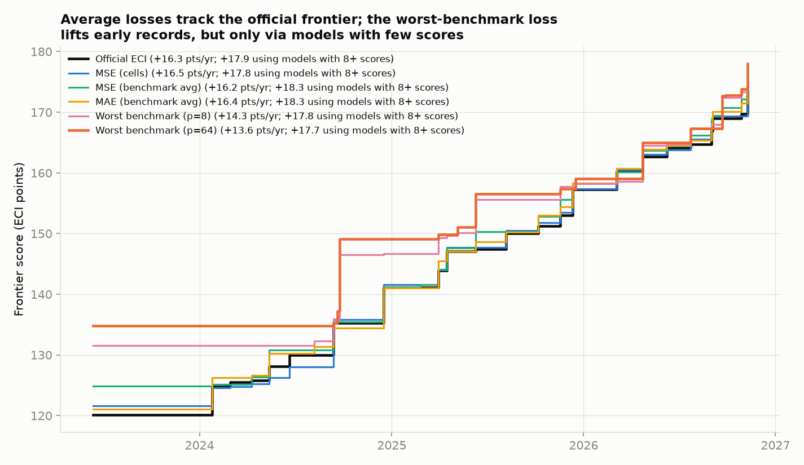

# What does the Epoch Capabilities Index lose?

The [Epoch Capabilities Index (ECI)](https://epoch.ai/eci) combines scores from many AI benchmarks into one number per model. This project asks what that aggregation keeps and what it loses, using the benchmark data Epoch publishes. How each number is computed is in [`METHODOLOGY.md`](METHODOLOGY.md).

**Sample:** 191 models × 29 benchmarks (2,078 scores; 37.5% of cells observed), logit scores.

## The argument

### 1. Aggregating many benchmarks into one number must lose some variation
The ECI, as a single score, explains **83%** of the variation within benchmarks (benchmarks weighted equally; 87% pooled). So **13–17% is lost**, and the loss is uneven. It explains 93–96% of METR Time Horizons, FrontierMath Tiers 1–3, GPQA, ARC-AGI and AIME, but only **23% of GeoBench**, 49% of MirrorCode, 55% of VPCT, 57% of Fiction.LiveBench, 61% of Mystery Game Puzzles and 62% of SimpleQA.



### 2. The ECI is essentially the first principal component of the benchmarks
Running PCA on the benchmarks (with benchmark intercepts estimated jointly with the factor, "AJ"), the first component correlates **r = 0.995** [0.994, 0.996] with the ECI. That one component explains **84%** of within-benchmark variation in-sample and **82%** on held-out cells. Out of sample, adding more components does not help. Conventional PCA (centering on observed benchmark means) understates this (r = 0.968, 66% in-sample, 60% held out) because the models tested on a benchmark are not representative: hard benchmarks were mostly run on strong models.




### 3. Remove what the ECI explains: what is left?
After subtracting from each benchmark the line that the ECI explains, the leftover variation is largest for the benchmarks in point 1: GeoBench, MirrorCode, VPCT, Fiction.LiveBench, Mystery Game Puzzles, SimpleQA. These are the benchmarks the ECI undervalues, or that measure something other than what it measures (geolocation, long-context fiction, visual reasoning, factual recall).

Is there shared structure in the leftover? Only weakly. Four eigenvalues are above a shuffled null, but adding the components to the ECI prediction makes held-out prediction **worse** (error up 15% with one component), and the components are only moderately stable under resampling (cosine 0.62–0.72). So the three axes below are tentative: for example, component E1 contrasts MirrorCode, APEX-Agents and ProofBench with chess, GeoBench, SimpleQA and VPCT.




### 4. The choice of loss function changes the result
The ECI is built to fit all benchmarks on average. If we instead choose the one-number score by a different loss, starting from the ECI:

| Loss | Mean R² | Worst R² | Corr. with ECI | SD of score change (points) | Max change (points) | Held-out mean R² | Held-out worst R² |
|---|---|---|---|---|---|---|---|
| Official ECI | 0.80 | 0.23 (GeoBench) | 1.000 | 0 | 0 | n/a | n/a |
| MSE, pooled cells | 0.80 | 0.25 | 0.997 | 1.1 | 5.3 | **0.74** | **0.17** |
| MSE, benchmark average | 0.82 | 0.28 | 0.990 | 2.0 | 6.7 | 0.70 | 0.14 |
| Absolute value (MAE), benchmark average | 0.81 | 0.23 | 0.992 | 1.8 | 8.2 | 0.65 | −0.27 |
| Worst benchmark (p = 8) | 0.77 | 0.67 | 0.945 | 4.6 | 19.6 | 0.61 | −0.01 |
| Worst benchmark (p = 64, about minimax) | 0.74 | 0.71 | 0.928 | 5.3 | 22.1 | 0.58 | −0.03 |

- Squared-error and absolute-value losses reproduce the ECI to within its own uncertainty (typical 95% half-width 2.5 points).
- A loss that cares about the worst-fitted benchmark does change the scores a lot: GeoBench's R² rises from 0.23 to 0.71, but benchmarks like METR, ARC-AGI and AIME drop from 0.93–0.96 to 0.72–0.78, and some models move by 20+ points (Gemini 1.5 Flash +22, Qwen 3.8 27B −21).
- But that loss is worse on held-out cells, both on average and in the worst case, and the models that move most have few scores. It is not obviously a better index, only a different one.





**Over time.** Like Epoch's chart of ECI against release date, `fig12` plots each measure against release date with its frontier (the models that set a record when they were released).
- The average losses track the official frontier: +16.2 to +16.5 points per year against +16.3 for the official ECI, with 75–88% of the same record-setting models.
- The worst-benchmark loss gives a flatter frontier (+13.6 per year at p = 64) and changes who sets records (28% overlap). But that comes from a few early models with few scores, such as GPT-4, Gemini 1.5 Flash and Qwen2.5-72B (6–9 scores each, boosted by 10–22 points). Among models with at least 8 scores, the frontier slope is the same under every loss (17.7–18.3 points per year).
- The newest frontier model (Claude Fable 5.2) is the same under every loss.




## Main caveats
(Full list in [`METHODOLOGY.md` §10](METHODOLOGY.md#10-caveats).)
- The data are sparse and not random; conclusions concern a 29-benchmark subset, and the ECI also uses other benchmarks.
- "Unexplained by the ECI" is a candidate list of undervalued benchmarks, not proof; some benchmarks may legitimately measure something else.
- The residual structure is weak and its labels are interpretation.
- My alternative-loss scores approximate the ECI with a simpler model (no priors or anchors); there is no external ground truth for "better", and the worst-benchmark loss is fragile in sparse data.
- Confidence intervals treat models as independent, so they are too narrow.

## Running it
```
pip install pandas numpy scipy matplotlib
python -I scripts/download_data.py data
python -I scripts/01_pc1_vs_eci.py       data/extracted results/01_pc1_vs_eci
python -I scripts/02_eci_residual.py     data/extracted results/02_eci_residual
python -I scripts/03_loss_functions.py   data/extracted results/03_loss_functions
python -I scripts/04_make_figures.py     data/extracted results
```

## Files
- `METHODOLOGY.md`: how every number is computed, with equations, scripts and caveats.
- `scripts/`: `common.py` (shared code), `download_data.py`, and `01_` to `04_` for the four steps and figures.
- `results/`: saved tables, logs, and `figures/` (`fig01`–`fig13`).

Data: Epoch AI, "Capabilities & benchmarking", https://epoch.ai/benchmarks (CC-BY 4.0). Not redistributed here; the download script fetches it.
